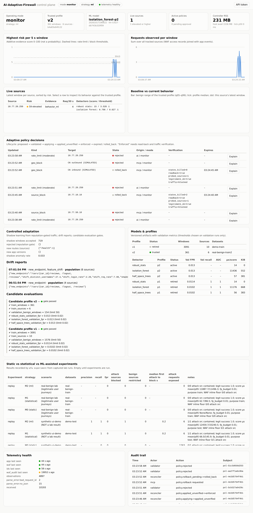
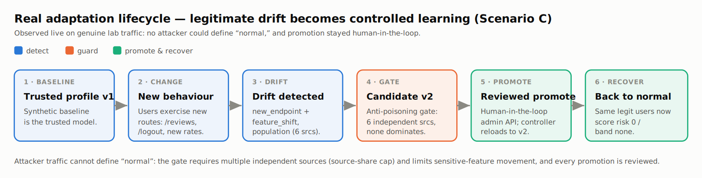
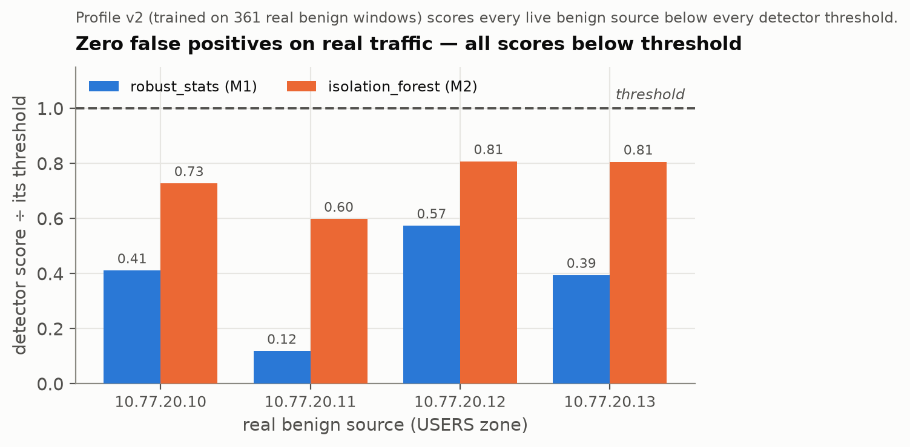
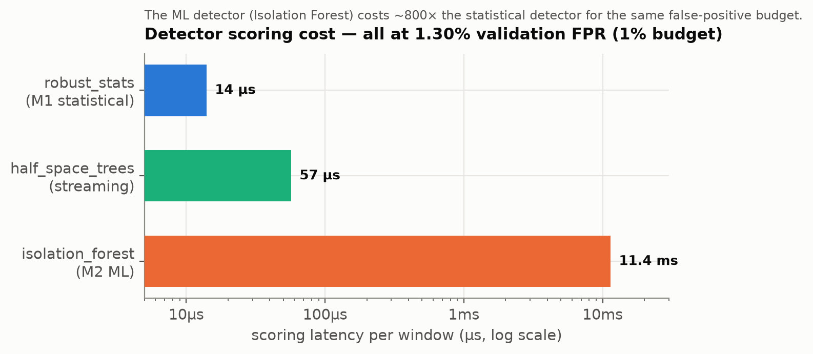
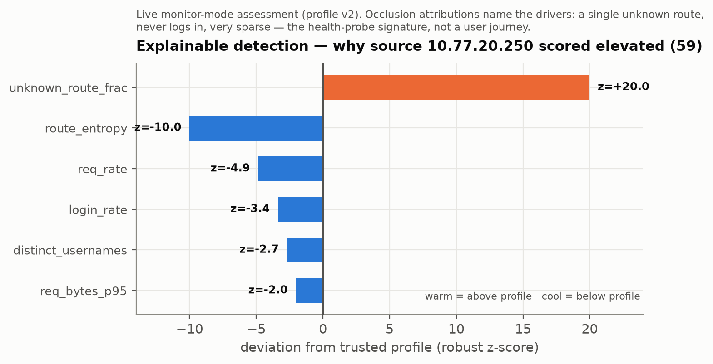

# AI-Adaptive-Firewall

**An application-aware firewall that learns what "normal" traffic looks like for a
specific web app, scores deviations from it, and acts only through a chain of
human-governed safety checks.** Built and evaluated end-to-end in an isolated GNS3
network lab, on top of production-grade enforcement engines (OPNsense + pf, Suricata
IDS, an OWASP CRS WAF) — the project's own contribution is the AI control plane that
closes the loop between them:

> **Observe → Detect → Correlate → Decide → Validate → Enforce → Verify → Learn.**

Three unsupervised ML detectors turn raw traffic into a 0–100 evidence score. A
non-ML validator has final veto power over every action. A background "shadow"
model continuously retrains itself and is evaluated against the live one — but a
challenger can only replace the live model after it passes a safety gate **and** a
human approves the promotion. Nothing the system learns from live traffic ever
reaches the real firewall unsupervised.


*The operator dashboard, rendered live against real lab traffic — operating mode,
trusted model, live risk scores, policy lifecycle, model/profile versions, and the
audit trail, all on one screen.*

## Start here

| If you want... | Read |
|---|---|
| A 5-minute explanation to give someone (prof, teammate, interviewer) | [`docs/EXPLAIN_THIS_PROJECT.md`](docs/EXPLAIN_THIS_PROJECT.md) |
| A plain-language walkthrough of how everything works, AI included | [`docs/HOW_IT_WORKS.md`](docs/HOW_IT_WORKS.md) |
| The system architecture, trust boundaries and failure behavior | [`docs/ARCHITECTURE.md`](docs/ARCHITECTURE.md) |
| What it defends against, and how | [`docs/THREAT_MODEL.md`](docs/THREAT_MODEL.md) |
| What's proven, what's limited, and what's honestly unfinished | [`docs/SECURITY_AND_LIMITATIONS.md`](docs/SECURITY_AND_LIMITATIONS.md) |
| Full milestone-by-milestone status and acceptance gates | [`docs/PROJECT_STATUS.md`](docs/PROJECT_STATUS.md) |

## What's real vs. simulated

This is worth saying up front, because it's a strength of the project, not a caveat
to bury:

- **The pipeline is 100% real.** Real mTLS-authenticated telemetry, real detector
  math (scikit-learn, River), real OPNsense/WAF API calls, real verification that an
  enforcement action actually took effect on the live backend.
- **Country-level blocking is real** — enforced via genuine GeoIP network tables
  pushed to OPNsense, not a lookup table pretending to block, capped at 40,000
  networks per direction as a demonstrable safety bound.
- **Traffic *scenarios* are the one deliberately simulated piece.** Attack traffic
  comes from scripted, team-run scenarios (e.g. credential brute-force via hydra) on
  an isolated attacker VM — not live internet attackers, because running real
  attack tooling against a public target isn't appropriate for a university project.
  This is disclosed, never hidden; see `docs/engineering/` for individual scenario
  reports.

## Quick start

```bash
# dev toolchain
uv sync
uv run pytest                 # unit + integration tests (+live-lab tests with AFW_LAB=1)
uv run mypy src && uv run ruff check src tests

# lab (GNS3 running — see docs/DEPLOYMENT.md for first-time host setup)
afw lab status                # node inventory + state
afw lab verify                # zone isolation checks

# AI / models
afw train status                               # profiles + models
afw experiment replay --datasets <held-out>    # model comparison

# controller + dashboard (on CTRL01 via systemd, or locally)
afw serve                     # :8080, HTTPS when AFW_TLS_CERT/KEY set; dashboard at /
claude mcp list                # confirm the `afw` MCP server is Connected
```

Dashboard over an SSH tunnel:
```bash
ssh -N -L 18080:10.77.50.10:8080 gns3@<host>
# then open https://localhost:18080/
# trust ~/.config/afw/pki/lab-ca.pem; token at ~/.config/afw/api/dashboard.token
```

## Architecture, at a glance

```
Claude / operator ──(MCP or HTTPS)──► controller API ──► validator ──► enforcement
                                           │                              │
                                   telemetry → features                FW01 (OPNsense pf+IDS)
                                   → 3 ML detectors                     WAF01 (OWASP CRS)
                                   → evidence score                           │
                                           │                        verified read-back
                                  shadow model (background,
                                  gated promotion only)

Data plane:  Client → FW01 → WAF01 → App → DB      (every box is a real VM, real software)
```

Modular monolith with hexagonal boundaries (`domain` / `ports` / adapters); SQLAlchemy
confined to `persistence`; everything crossing a boundary is a typed Pydantic model.
Full breakdown of flows and trust boundaries: `docs/ARCHITECTURE.md`.


*This is the adaptive loop in practice, captured on genuine lab traffic: real users
exercise new routes, drift is detected, a candidate model is trained and put through
the anti-poisoning gate, and only then — reviewed — is it promoted. Attacker traffic
cannot define "normal" on its own: no single source, or small colluding set, can pass
the gate alone.*

## Tech stack

| Layer | Technology |
|---|---|
| Lab infrastructure | GNS3 + QEMU — every node is a real VM |
| Firewall | OPNsense (FreeBSD), controlled only via its own HTTPS REST API |
| Controller | Python 3.12, FastAPI, Uvicorn, Pydantic |
| ML detectors | scikit-learn (Isolation Forest), River (online half-space trees), NumPy |
| Telemetry transport | mutual TLS — sensors authenticate to the controller, not just the other way round |
| Storage | PostgreSQL via SQLAlchemy + Alembic |
| Dashboard | Plain HTML/CSS/JS served by the controller, HTTPS JSON API with bearer tokens |
| AI-agent control surface | MCP (Model Context Protocol) — same validated actions as the dashboard |
| Provisioning | Ansible playbooks, driven by the project's own `afw` CLI (Typer) |

## Measured, not just designed

Every number below comes from committed evidence files, never a synthetic demo —
see `docs/figures/README.md` for exact sources and regeneration commands, and
`docs/RESULTS.md` for the full write-up, including the results that don't flatter
the project.

<table>
<tr>
<td width="50%">


*On genuine lab traffic, the trusted profile scores every live benign source below
every detector's threshold.*

</td>
<td width="50%">


*The measured price of the ML detector over the statistical one, at the same
validation false-positive rate: ~800× the latency for a potentially richer signal.*

</td>
</tr>
</table>


*Every risk score is explainable, not a black box: occlusion-based attribution on a
real live assessment shows exactly which features drove this source's score up —
here, a health-probe process correctly flagged for hitting an unknown route and
never logging in, not an attack.*

## Project status

The system runs end to end on the real lab: telemetry, detection, correlation,
validated and verified enforcement, a dashboard, an MCP interface, and a governed
online-learning lifecycle (shadow challenger → gate → human promotion → probation
rollback). It is run in **monitor mode** by default because the current detectors
still have a measurable false-positive rate on genuinely new (but benign) traffic —
this is shown live, not hidden, and is exactly why the mode-tiered safety design
exists. Attack-side scenario evaluation is ongoing via team-run scripted runs (see
`docs/engineering/`). For the authoritative, milestone-by-milestone breakdown of
what's done, partial, and open, see `docs/PROJECT_STATUS.md`.

## Documentation map

The "Start here" table above covers what most readers need. Everything else:

| Doc | Purpose |
|---|---|
| `docs/VALIDATION_MATRIX.md` | Every acceptance criterion → tests → evidence |
| `docs/COMPONENT_INVENTORY.md` | Nodes, ports, source tree, entry points |
| `docs/ARCHITECTURE_DECISIONS.md` | Architecture decision records (ADR-001…033) |
| `docs/AI_RESEARCH.md` | Research question, contribution, detectors, leakage controls |
| `docs/ADAPTATION_DESIGN.md` | Online learning, promotion gate, rollback, in depth |
| `docs/EXPERIMENTS.md` / `docs/RESULTS.md` | Methodology and measured results, including negative ones |
| `docs/DEPLOYMENT.md` | Install, configuration, recovery |
| `docs/OPERATOR_GUIDE.md`, `docs/MCP_GUIDE.md` | Day-to-day operation |
| `docs/FINAL_DEMO.md` | Repeatable demonstration script |
| `docs/GNS3_TOPOLOGY.md` | Live network topology |
| `docs/engineering/` | Milestone design notes and individual scenario/session reports (engineering history) |
| `docs/archive/` | Superseded status snapshots, kept for history only |

## Safety & integrity

All activity happens inside the isolated lab. Secrets live under `~/.config/afw/`
and are never committed to Git. Synthetic fixtures are used only to test software
correctness and are never cited as research results — every experiment row records
whether it came from a synthetic demo or a real captured lab run.
